# Tally — by Qorelly

> Inventory and point of sale for Nigerian SMEs, plus the Q Vision console that trains product-recognition models against the Qore Catalog.

- **Merchants** sign in with their Qorelly account and run stock and sales from the web portal (`mp`) or the mobile app (`qore_tally`).
- **Q Vision operators** upload product images in the `console`, link them to Qore Catalog products, and run distillation in `services/train`.
- **Tally** lives in the `tally` schema of the shared Qorelly Supabase project and reuses Qorelly's `auth.users`.

Status: sign-in on every surface; web onboarding (business + starter inventory from Qore Catalog templates); barcode scan-to-find on mobile. Photo → inventory, POS and Q Vision are planned (see the [system flowchart](docs/diagrams/images/system-flowchart.svg)).

---

## Built during the Meta hackathon

This repository was created for the **Meta Global AI Developer Hackathon**. The first commit ([`1406a71`](https://github.com/usecorehq/tally/commit/1406a71), the monorepo scaffold) was made on **26 Oct 2026** after kickoff; **all code in this repository was written during the hackathon.**

**New in this repo**

| Area | What | PRs |
|---|---|---|
| Platform | pnpm + turbo monorepo (api, mp, console, mobile, train), CI (path-filtered jobs, tests, schema-drift check), secret-scanning guard, architecture docs and diagrams | [#1](https://github.com/usecorehq/tally/pull/1), [#6](https://github.com/usecorehq/tally/pull/6), [#11](https://github.com/usecorehq/tally/pull/11), [#14](https://github.com/usecorehq/tally/pull/14) |
| Database | `tally` schema: businesses, inventory, append-only stock movements, sales and payments, with triggers that keep stock and paid amounts consistent | [#9](https://github.com/usecorehq/tally/pull/9), [#10](https://github.com/usecorehq/tally/pull/10) |
| Catalogue integration | Typed client for the Qore Catalog v1 API; Tally's API is the only place holding the catalogue key | [#3](https://github.com/usecorehq/tally/pull/3), [#12](https://github.com/usecorehq/tally/pull/12), [#13](https://github.com/usecorehq/tally/pull/13) |
| Onboarding | Create a business from a catalogue business type; turn its template into a starter inventory; every keep/swap/remove decision is sent back to the catalogue as feedback | [#15](https://github.com/usecorehq/tally/pull/15), [#16](https://github.com/usecorehq/tally/pull/16) |
| Barcode scan | Scan to find an item in the merchant's stock; on-device cache, link unknown barcodes once | [#17](https://github.com/usecorehq/tally/pull/17), [#18](https://github.com/usecorehq/tally/pull/18) |
| Mobile | Flutter app for Android and iOS with dev / staging / prod builds | [#2](https://github.com/usecorehq/tally/pull/2), [#4](https://github.com/usecorehq/tally/pull/4), [#5](https://github.com/usecorehq/tally/pull/5) |

**Existing before the hackathon (used, not built here)**

| | Role in Tally |
|---|---|
| **Qore Catalog** (Core Technologies) | Separate product and repository: the Nigerian product catalogue Tally calls for business types, templates, product search, matching and feedback |
| **Qorelly** (Core Technologies) | Merchants' existing accounts (shared Supabase Auth), and the design system: Tally's `@tally/ui` components and icons are ported from Qorelly's |

---

## Stack at a glance

| Layer | Tech |
|---|---|
| Web | Next.js 16 (App Router), Tailwind 4, NextAuth v5 (Credentials → Supabase) — `apps/mp`, `apps/console` |
| Mobile | Flutter, clean architecture, flutter_bloc (bloc + cubit), dartz `Either`, get_it, supabase_flutter, Dio — `apps/mobile` |
| Backend | NestJS 11, Drizzle on `postgres.js`, class-validator env, Swagger at `/docs` — `apps/api` |
| Training | Python 3.12, FastAPI, uv — `services/train` |
| DB | Shared Qorelly Supabase Postgres, `tally` schema only; ledger `tally.__drizzle_migrations` |
| Auth | Qorelly Supabase Auth. API verifies JWTs (HS256 or JWKS), `audience: authenticated` enforced |
| Product data | Qore Catalog API (`/v1`, `x-api-key`, server-only) |

---

## Quick start

**Prerequisites:** Node ≥ 20.19, pnpm ≥ 10, Python 3.12 + uv, Flutter (for mobile), a running Qore Catalog API, and access to the Qorelly Supabase staging project.

```bash
pnpm install                  # also turns on the secret-scanning pre-commit hook
cp .env.example .env          # one root env; apps may also have their own .env (see each app's .env.example)
# fill Supabase + Qore Catalog values — docs/guides/local-development.md
pnpm dev                      # builds packages, then api + mp + console
```

| URL | What |
|---|---|
| http://localhost:3000 | console |
| http://localhost:3001 | mp (merchant portal) |
| http://localhost:4100/api/health | API health + Qore Catalog status |
| http://localhost:4100/docs | Swagger — paste a Supabase access token |
| http://localhost:4200/health | train service (`uv run uvicorn train.main:app --port 4200`) |

Full walkthrough: **[docs/guides/local-development.md](docs/guides/local-development.md)**.

---

## Monorepo layout

```
apps/
  api/               NestJS + Drizzle. Global SupabaseJwtGuard, health, catalog.   README + .env.example
  console/           Next.js. Q Vision distillation console.                       README + .env.example
  mp/                Next.js. Merchant portal: signup, onboarding, POS, inventory.  README + .env.example
  mobile/            Flutter app qore_tally: android + ios, dev/staging/prod flavors. README + .env.example
services/
  train/             FastAPI + uv. Q Vision training / distillation.                README
packages/
  db/                Drizzle schema + client for the tally schema, migrations/.
  auth/              NextAuth v5 config over shared Supabase Auth.
  catalog-client/    Qore Catalog API client (x-api-key).
  ui/                Shared React components: Qorelly Design V2 (trays, sheets, 12px buttons).
  tsconfig/          base.json, node.json, next.json.
docs/
  architecture/      Why we built it this way.
  guides/            How to run, migrate, and keep docs current.
  diagrams/          C4 model, sequences, flows, journeys (mermaid/ source, images/ SVG).
scripts/
  check-secrets.sh   Secret guard (pre-commit hook + CI). See "Secret guard" below.
  render-diagrams.sh pnpm docs:diagrams.
.githooks/           pre-commit → scripts/check-secrets.sh --staged.
```

---

## Documentation

Everything lives under [`docs/`](docs/README.md). Docs ship in the same PR as the code they describe.

<table>
<tr>
<td align="center"><br/><b>A</b> — C4 Context: merchants, Q Vision operators, Tally, the shared Qorelly Supabase and the Qore Catalog API</td>
<td align="center"><br/><b>B</b> — C4 Container: mp, console, mobile, api, train and Postgres, and how they authenticate and talk</td>
</tr>
</table>

More in **[Architecture diagrams](docs/diagrams/README.md)**: auth sequences (web + mobile), database isolation, migration flow, mobile layers and flavors, system flowchart, Q Vision flow, merchant journey.

### Architecture

- **[Auth](docs/architecture/auth.md)** — One identity (Qorelly `auth.users`), three session holders, one API guard.
- **[Database](docs/architecture/database.md)** — `tally` schema in a shared database, and why our ledger isn't Drizzle's default.
- **[Onboarding](docs/architecture/onboarding.md)** — Business from a Qore Catalog sub-type, starter inventory from its template, feedback back to the catalogue.
- **[Barcode scan](docs/architecture/barcode-scan.md)** — Scan to find an item in the merchant's own inventory.
- **[Qore Catalog integration](docs/architecture/catalog.md)** — Where the API key may and may not go.
- **[Mobile app](docs/architecture/mobile.md)** — Layers, `Either<Failure, T>`, get_it, bloc vs cubit.
- **[Mobile flavors](docs/architecture/mobile-flavors.md)** — `dev` / `staging` / `prod`, per-environment `.env`, gotchas.
- **[Q Vision distillation](docs/architecture/qvision-distillation.md)** — Planned flow and the open questions.

### Guides

- **[Local development](docs/guides/local-development.md)**
- **[Database migrations](docs/guides/database-migrations.md)**
- **[Keeping docs current](docs/guides/documentation.md)**

---

## Common commands

```bash
# Dev
pnpm dev                              # every app (packages built first)
pnpm --filter @tally/api dev
pnpm --filter @tally/mp dev
pnpm --filter @tally/console dev
(cd apps/mobile && flutter run --flavor dev -t lib/main_dev.dart --dart-define-from-file=.env.dev)   # flavors: apps/mobile/README.md

# Quality (same as CI)
pnpm typecheck
pnpm test                             # every package's tests (turbo)
pnpm db:check                         # schema.ts matches the committed migrations
pnpm build
(cd services/train && uv run ruff check . && uv run pytest -q)
(cd apps/mobile && flutter analyze && flutter test)

# Database (staging only — production is applied by the CTO)
pnpm db:generate --name=<what_changed>
pnpm db:migrate
pnpm db:studio

# Docs
pnpm docs:diagrams                    # re-render every Mermaid diagram
pnpm docs:diagrams c4-container       # just one

# Secrets
pnpm check:secrets                    # scan every tracked file for keys
```

---

## Secret guard

Real keys never enter git. One script, [`scripts/check-secrets.sh`](scripts/check-secrets.sh), runs in two places:

| Where | When | What it scans |
|---|---|---|
| Pre-commit hook (`.githooks/pre-commit`) | every `git commit` | staged changes |
| CI job `secrets` | every PR and push to `staging` | all tracked files + the PR's diff |

It blocks Qore Catalog keys (`qcat_live_…` / `qcat_test_…`), Supabase secret keys (`sb_secret_…`), private keys (`-----BEGIN … PRIVATE KEY-----`) and AWS access key IDs, and prints `file:line` with the value redacted.

**Setup:** automatic. `pnpm install` runs `prepare`, which sets `git config core.hooksPath .githooks`. To turn it on by hand (e.g. a fresh clone before installing):

```bash
git config core.hooksPath .githooks
```

**If it blocks you:** move the value into a gitignored `.env` (never a `.env.example`), restage, commit. If a real key was ever pushed, revoke it — removing it from the repo is not enough. Use `git commit --no-verify` only for a confirmed false positive; CI checks anyway.

**Adding a pattern:** append an extended regex to `PATTERNS` in `scripts/check-secrets.sh` (and to `redact()` so it stays hidden in output). Keep patterns specific — a noisy guard gets bypassed.

## Credits

- **Icons (web):** [Phosphor Icons](https://phosphoricons.com), MIT. Compiled to inline SVG data; no other changes. See [`packages/ui/src/icons/LICENSE.md`](packages/ui/src/icons/LICENSE.md).
- **Mobile icons:** [Phosphor Icons](https://phosphoricons.com) (Light and Fill), [MIT](apps/mobile/assets/fonts/phosphor/LICENSE), as icon fonts ported with Qorelly's mobile design kit.
- **Font:** [Inter](https://rsms.me/inter/) by Rasmus Andersson, [SIL Open Font License 1.1](https://openfontlicense.org), loaded with `next/font`.

## Contributing

Branch from `staging`, PR into `staging`. Conventional commits (`feat(api): …`, `docs: …`), no AI co-author. See [docs/README.md](docs/README.md#contributing).
