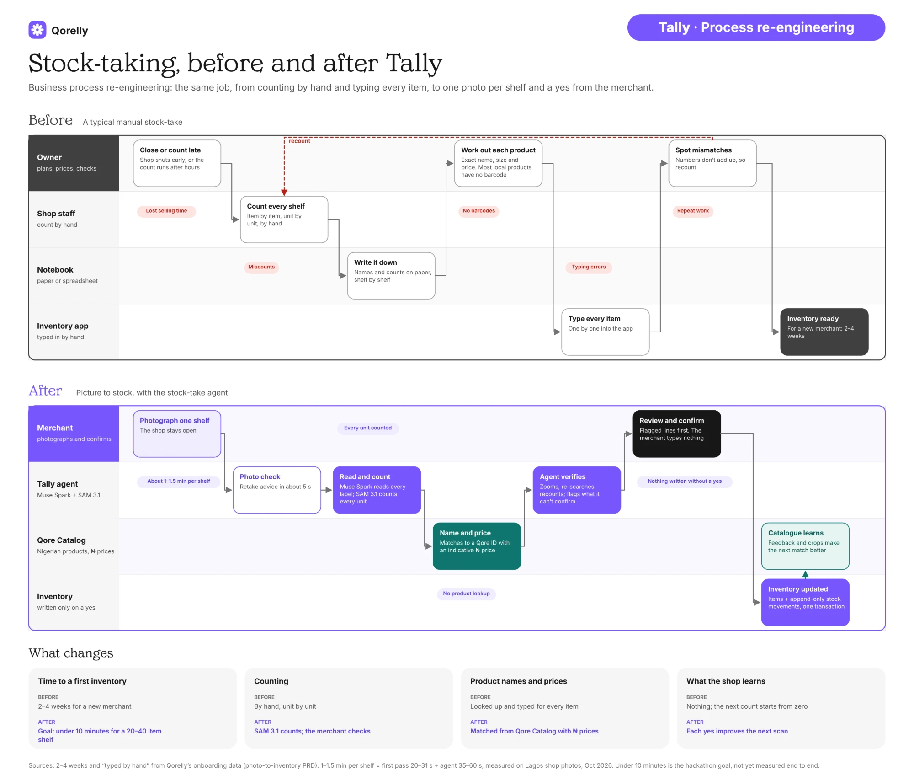
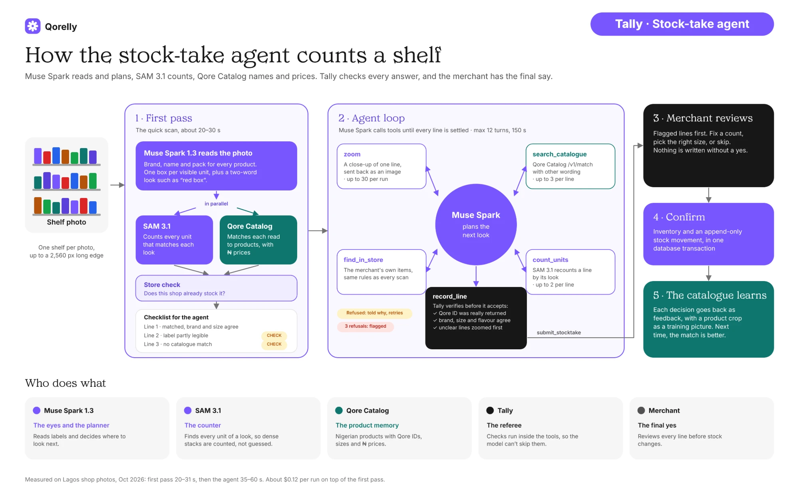

# Tally — by Qorelly

> Photo-to-inventory and stock-taking for Nigerian SMEs, built on Meta's Muse Spark and SAM 3.1 plus the Qore Catalog.

- **Merchants** sign in with their Qorelly account and count and manage their stock from the web portal (`mp`) or the mobile app (`qore_tally`).
- **Qore Catalog** (a separate product) owns product images and recognition training; Tally sends it confirmed shelf crops and feedback.
- **Tally** lives in the `tally` schema of the shared Qorelly Supabase project and reuses Qorelly's `auth.users`.

Status: **web portal (`mp`)**: sign-in, onboarding from Qore Catalog templates, and photo-to-inventory stock-taking (photo check, quick scan or the stock-take agent with a live trace, review with flagged lines first, confirm), with stock-take history, rerun and discard. **Mobile (`qore_tally`)**: sign-in, onboarding, barcode scan-to-find, and stock-take (quick scan or agent, review, confirm). **Qore Catalog loop**: every decision goes back as feedback, product crops (including new items) as training samples, and curator resolutions sync back every 15 minutes. Planned: an on-device recognition model. See [vision recognition](docs/architecture/vision-recognition.md) and [how a stock-take works](docs/diagrams/2.stock-take-agent-highlevel.webp).

## Why Tally: stock-taking, before and after

The same job, from counting by hand and typing every item to one photo per shelf and a yes from the merchant.



## How the stock-take agent counts a shelf

Muse Spark reads and plans, SAM 3.1 counts, Qore Catalog names and prices. Tally checks every answer, and the merchant has the final say. Details: [stock-take agent](docs/architecture/stocktake-agent.md) and [vision recognition](docs/architecture/vision-recognition.md).



---

## Built during the Meta hackathon

This repository was created for the **Meta Global AI Developer Hackathon**. The first commit ([`1406a71`](https://github.com/usecorehq/tally/commit/1406a71), the monorepo scaffold) was made on **26 Oct 2026** after kickoff; **all code in this repository was written during the hackathon.**

**New in this repo**

| Area | What | PRs |
|---|---|---|
| Platform | pnpm + turbo monorepo (api, mp, mobile), CI (path-filtered jobs, tests, schema-drift check), secret-scanning guard, Docker image for Coolify, Postman collection, architecture docs and diagrams | [#1](https://github.com/usecorehq/tally/pull/1), [#6](https://github.com/usecorehq/tally/pull/6), [#11](https://github.com/usecorehq/tally/pull/11), [#14](https://github.com/usecorehq/tally/pull/14), [#32](https://github.com/usecorehq/tally/pull/32), [#39](https://github.com/usecorehq/tally/pull/39) |
| Database | `tally` schema: businesses, inventory, append-only stock movements, with triggers that keep stock on hand consistent; vision tables for scans, lines, readings and agent runs | [#9](https://github.com/usecorehq/tally/pull/9), [#10](https://github.com/usecorehq/tally/pull/10), [#24](https://github.com/usecorehq/tally/pull/24), [#31](https://github.com/usecorehq/tally/pull/31) |
| Catalogue integration | Typed client for the Qore Catalog v1 API; Tally's API is the only place holding the catalogue key; match strength and catalogue image on every candidate | [#3](https://github.com/usecorehq/tally/pull/3), [#12](https://github.com/usecorehq/tally/pull/12), [#13](https://github.com/usecorehq/tally/pull/13), [#47](https://github.com/usecorehq/tally/pull/47) |
| Onboarding | Create a business from a catalogue business type; turn its template into a starter inventory; every keep/swap/remove decision is sent back to the catalogue as feedback | [#15](https://github.com/usecorehq/tally/pull/15), [#16](https://github.com/usecorehq/tally/pull/16), [#41](https://github.com/usecorehq/tally/pull/41) |
| Barcode scan | Scan to find an item in the merchant's stock; on-device cache, link unknown barcodes once | [#17](https://github.com/usecorehq/tally/pull/17), [#18](https://github.com/usecorehq/tally/pull/18) |
| Vision recognition | Shelf photo → Muse Spark 1.3 reads every product, SAM 3.1 counts the units, Qore Catalog matches with ₦ prices, checked against the shop's own stock. The merchant reviews (flagged lines first, nothing written without a yes) and confirms in one transaction. Photo check before scanning, count-agreement rule, unread-area shading, product picker, identify one product | [#22](https://github.com/usecorehq/tally/pull/22), [#23](https://github.com/usecorehq/tally/pull/23), [#24](https://github.com/usecorehq/tally/pull/24), [#25](https://github.com/usecorehq/tally/pull/25), [#26](https://github.com/usecorehq/tally/pull/26), [#27](https://github.com/usecorehq/tally/pull/27), [#28](https://github.com/usecorehq/tally/pull/28), [#35](https://github.com/usecorehq/tally/pull/35), [#45](https://github.com/usecorehq/tally/pull/45), [#51](https://github.com/usecorehq/tally/pull/51), [#53](https://github.com/usecorehq/tally/pull/53), [#64](https://github.com/usecorehq/tally/pull/64), [#71](https://github.com/usecorehq/tally/pull/71), [#73](https://github.com/usecorehq/tally/pull/73), [#75](https://github.com/usecorehq/tally/pull/75), [#76](https://github.com/usecorehq/tally/pull/76) |
| Stock-take agent | Muse Spark tool calling (zoom, catalogue search, store check, SAM recount, record) with Tally verifying every record (real Qore ID; brand, size and flavour agree), escalation of what it can't settle, a live step trace, fallback to the quick scan, and a benchmark harness (with an experimental shelf sweep) | [#31](https://github.com/usecorehq/tally/pull/31), [#33](https://github.com/usecorehq/tally/pull/33), [#36](https://github.com/usecorehq/tally/pull/36), [#43](https://github.com/usecorehq/tally/pull/43), [#63](https://github.com/usecorehq/tally/pull/63), [#67](https://github.com/usecorehq/tally/pull/67), [#68](https://github.com/usecorehq/tally/pull/68), [#83](https://github.com/usecorehq/tally/pull/83) |
| Stock-take history | Every stock-take is a session at its own URL, reopenable on any device; the shelf photo is kept for audit; rerun on the stored photo, discard, and only one confirmed run per photo | [#56](https://github.com/usecorehq/tally/pull/56), [#59](https://github.com/usecorehq/tally/pull/59), [#66](https://github.com/usecorehq/tally/pull/66), [#70](https://github.com/usecorehq/tally/pull/70) |
| Qore Catalog feedback loop | Every confirmed decision goes back as feedback; product crops go as training samples (from 96 px, with the label and box); new-item crops too; curator resolutions sync back every 15 minutes | [#25](https://github.com/usecorehq/tally/pull/25), [#30](https://github.com/usecorehq/tally/pull/30), [#57](https://github.com/usecorehq/tally/pull/57), [#81](https://github.com/usecorehq/tally/pull/81), [#84](https://github.com/usecorehq/tally/pull/84) |
| Mobile | Flutter app for Android and iOS with dev / staging / prod builds; stock-take from a shelf photo on the Qorelly design system | [#2](https://github.com/usecorehq/tally/pull/2), [#4](https://github.com/usecorehq/tally/pull/4), [#5](https://github.com/usecorehq/tally/pull/5), [#49](https://github.com/usecorehq/tally/pull/49) |

**Existing before the hackathon (used, not built here)**

| | Role in Tally |
|---|---|
| **Qore Catalog** (Core Technologies) | Separate product and repository: the Nigerian product catalogue Tally calls for business types, templates, product search, matching, feedback, product images and training samples, and curation |
| **Qorelly** (Core Technologies) | Merchants' existing accounts (shared Supabase Auth), and the design system: Tally's `@tally/ui` components and icons are ported from Qorelly's |

---

## Stack at a glance

| Layer | Tech |
|---|---|
| Web | Next.js 16 (App Router), Tailwind 4, NextAuth v5 (Credentials → Supabase) — `apps/mp` |
| Mobile | Flutter, clean architecture, flutter_bloc (bloc + cubit), dartz `Either`, get_it, supabase_flutter, Dio — `apps/mobile` |
| Backend | NestJS 11, Drizzle on `postgres.js`, class-validator env, Swagger at `/docs` — `apps/api` |
| DB | Shared Qorelly Supabase Postgres, `tally` schema only; ledger `tally.__drizzle_migrations` |
| Auth | Qorelly Supabase Auth. API verifies JWTs (HS256 or JWKS), `audience: authenticated` enforced |
| Product data | Qore Catalog API (`/v1`, `x-api-key`, server-only) |

---

## Quick start

**Prerequisites:** Node ≥ 20.19, pnpm ≥ 10, Flutter (for mobile), a running Qore Catalog API, and access to the Qorelly Supabase staging project.

```bash
pnpm install                  # also turns on the secret-scanning pre-commit hook
cp .env.example .env          # one root env; apps may also have their own .env (see each app's .env.example)
# fill Supabase + Qore Catalog values — docs/guides/local-development.md
pnpm dev                      # builds packages, then api + mp
```

| URL | What |
|---|---|
| http://localhost:3001 | mp (merchant portal) |
| http://localhost:4100/api/health | API health + Qore Catalog status |
| http://localhost:4100/docs | Swagger — paste a Supabase access token |

Full walkthrough: **[docs/guides/local-development.md](docs/guides/local-development.md)**.

---

## Monorepo layout

```
apps/
  api/               NestJS + Drizzle. Global SupabaseJwtGuard, health, catalog.   README + .env.example
  mp/                Next.js. Merchant portal: signup, onboarding, stock-take, inventory. README + .env.example
  mobile/            Flutter app qore_tally: android + ios, dev/staging/prod flavors. README + .env.example
packages/
  db/                Drizzle schema + client for the tally schema, migrations/.
  auth/              NextAuth v5 config over shared Supabase Auth.
  catalog-client/    Qore Catalog API client (x-api-key).
  ui/                Shared React components: Qorelly Design V2 (trays, sheets, 12px buttons).
  tsconfig/          base.json, node.json, next.json.
docs/
  architecture/      Why we built it this way.
  guides/            How to run, migrate, and keep docs current.
  diagrams/          Process and agent overviews (.webp), plus C4, sequences, flows and journeys (images/).
scripts/
  check-secrets.sh   Secret guard (pre-commit hook + CI). See "Secret guard" below.
.githooks/           pre-commit → scripts/check-secrets.sh --staged.
```

---

## Documentation

Everything lives under [`docs/`](docs/README.md). Docs ship in the same PR as the code they describe.

<table>
<tr>
<td align="center"><br/><b>A</b> — C4 Context: merchants, Tally, the shared Qorelly Supabase and the Qore Catalog API</td>
<td align="center"><br/><b>B</b> — C4 Container: mp, mobile, api and Postgres, and how they authenticate and talk</td>
</tr>
</table>

More in **[Architecture diagrams](docs/diagrams/README.md)**: the stock-take agent run, quick scan, stock-take history, identify one product, onboarding, database (ERD, migration flow), mobile layers and flavors.

### Architecture

- **[Auth](docs/architecture/auth.md)** — One identity (Qorelly `auth.users`), three session holders, one API guard.
- **[Database](docs/architecture/database.md)** — `tally` schema in a shared database, and why our ledger isn't Drizzle's default.
- **[Onboarding](docs/architecture/onboarding.md)** — Business from a Qore Catalog sub-type, starter inventory from its template, feedback back to the catalogue.
- **[Barcode scan](docs/architecture/barcode-scan.md)** — Scan to find an item in the merchant's own inventory.
- **[Qore Catalog integration](docs/architecture/catalog.md)** — Where the API key may and may not go.
- **[Mobile app](docs/architecture/mobile.md)** — Layers, `Either<Failure, T>`, get_it, bloc vs cubit.
- **[Mobile flavors](docs/architecture/mobile-flavors.md)** — `dev` / `staging` / `prod`, per-environment `.env`, gotchas.
- **[Q Vision](docs/architecture/qvision-distillation.md)** — Moved to Qore Catalog.

### Guides

- **[Local development](docs/guides/local-development.md)**
- **[Database migrations](docs/guides/database-migrations.md)**
- **[Keeping docs current](docs/guides/documentation.md)**

---

## Common commands

```bash
# Dev
pnpm dev                              # every app (packages built first)
pnpm --filter @tally/api dev
pnpm --filter @tally/mp dev
(cd apps/mobile && flutter run --flavor dev -t lib/main_dev.dart --dart-define-from-file=.env.dev)   # flavors: apps/mobile/README.md

# Quality (same as CI)
pnpm typecheck
pnpm test                             # every package's tests (turbo)
pnpm db:check                         # schema.ts matches the committed migrations
pnpm build
(cd apps/mobile && flutter analyze && flutter test)

# Database (staging only — production is applied by the CTO)
pnpm db:generate --name=<what_changed>
pnpm db:migrate
pnpm db:studio

# Secrets
pnpm check:secrets                    # scan every tracked file for keys
```

---

## Secret guard

Real keys never enter git. One script, [`scripts/check-secrets.sh`](scripts/check-secrets.sh), runs in two places:

| Where | When | What it scans |
|---|---|---|
| Pre-commit hook (`.githooks/pre-commit`) | every `git commit` | staged changes |
| CI job `secrets` | every PR and push to `staging` | all tracked files + the PR's diff |

It blocks Qore Catalog keys (`qcat_live_…` / `qcat_test_…`), Supabase secret keys (`sb_secret_…`), private keys (`-----BEGIN … PRIVATE KEY-----`) and AWS access key IDs, and prints `file:line` with the value redacted.

**Setup:** automatic. `pnpm install` runs `prepare`, which sets `git config core.hooksPath .githooks`. To turn it on by hand (e.g. a fresh clone before installing):

```bash
git config core.hooksPath .githooks
```

**If it blocks you:** move the value into a gitignored `.env` (never a `.env.example`), restage, commit. If a real key was ever pushed, revoke it — removing it from the repo is not enough. Use `git commit --no-verify` only for a confirmed false positive; CI checks anyway.

**Adding a pattern:** append an extended regex to `PATTERNS` in `scripts/check-secrets.sh` (and to `redact()` so it stays hidden in output). Keep patterns specific — a noisy guard gets bypassed.

## Credits

- **Icons (web):** [Phosphor Icons](https://phosphoricons.com), MIT. Compiled to inline SVG data; no other changes. See [`packages/ui/src/icons/LICENSE.md`](packages/ui/src/icons/LICENSE.md).
- **Mobile icons:** [Phosphor Icons](https://phosphoricons.com) (Light and Fill), [MIT](apps/mobile/assets/fonts/phosphor/LICENSE), as icon fonts ported with Qorelly's mobile design kit.
- **Font:** [Inter](https://rsms.me/inter/) by Rasmus Andersson, [SIL Open Font License 1.1](https://openfontlicense.org), loaded with `next/font`.

## Contributing

Branch from `staging`, PR into `staging`. Conventional commits (`feat(api): …`, `docs: …`), no AI co-author. See [docs/README.md](docs/README.md#contributing).
